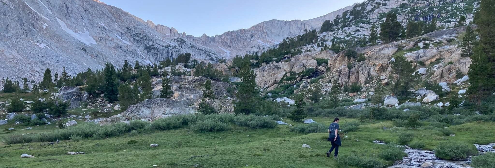

<h1 align="center">Conness GIS</h1>

Conness GIS is an open-source framework for building GIS web apps on [MapLibre GL JS](https://maplibre.org/). You build an app in its editor, which runs on your own computer, and everything it saves is a set of plain files you can also edit by hand. I built it as an open alternative to the proprietary "settings-to-GIS-app" builders. It's named after the [mountain in the Sierra Nevada](https://en.wikipedia.org/wiki/Mount_Conness).


## What comes with it

- Layers from GeoJSON, PMTiles (vector or raster), FlatGeobuf, GeoParquet, tile servers and ArcGIS REST services. GeoParquet runs on DuckDB in the browser.
- Layer list, legend, basemap, search, measure, draw, bookmarks and coordinates widgets to turn on and place. Or write your own.
- Feature popups from templates you control.
- Color presets, and every color can be changed.
- Mobile ready out the box. A button in the editor to see how they look there.
- Build turns a project into a zip you can put on any static host.

## Quick start

You need Node 24 or newer (26 recommended).

1. Download the latest zip from the [Releases](https://conness-gis.com/getting-started/releases/) page and unzip it.
2. Install and start the editor from its `app/` folder:

    ```bash
    cd app
    npm ci
    npm start
    ```

3. Open the local URL it prints (<http://localhost:5173> by default) and click **New project**.

You can also clone this repo, which comes with a few demo projects. The full walkthrough is in the [Quick Start](https://conness-gis.com/getting-started/quick-start/).

## Documentation

Everything is at [conness-gis.com](https://conness-gis.com):

- [Quick Start](https://conness-gis.com/getting-started/quick-start/)
- [The Editor](https://conness-gis.com/editor/projects/)
- [Configuration](https://conness-gis.com/configuration/branding/)
- [Widgets](https://conness-gis.com/widgets/placing-widgets/)
- [Guides](https://conness-gis.com/guides/your-first-widget/)

## Contributing

Pull requests are welcome. Just know there are two different things here:

- **Building your own app** doesn't need a fork. Please download a release and keep it in a repo of your own, like the Quick Start's [Put it on GitHub](https://conness-gis.com/getting-started/quick-start/#put-it-on-github) section shows. That copy can't open pull requests back here.
- **Changing Conness GIS itself** is the fork route. Fork this repo, make a branch, and open a pull request from your fork. Run `npm run typecheck`, `npm run lint` and `npm run test` in `app/` before you do.
- PR's should mostly be against the shell code, preferably. Read the [Internals](https://conness-gis.com/internals/architecture/) documentation before making a contribution.

Contributions are accepted under the same license as the project. AI is fine but you better be prepared to explain the change and how it affects the project as a whole.

## Built with

**Core**

- [MapLibre GL JS](https://github.com/maplibre/maplibre-gl-js)
- [React](https://github.com/facebook/react)
- [Zustand](https://github.com/pmndrs/zustand)
- [Vite](https://github.com/vitejs/vite)
- [Tailwind CSS](https://github.com/tailwindlabs/tailwindcss)
- [Zod](https://github.com/colinhacks/zod)

**Geospatial**

- [PMTiles](https://github.com/protomaps/PMTiles)
- [flatgeobuf](https://github.com/flatgeobuf/flatgeobuf)
- [DuckDB-WASM](https://github.com/duckdb/duckdb-wasm)
- [esri-gl](https://github.com/muimsd/esri-gl)
- [Mapbox GL Draw](https://github.com/mapbox/mapbox-gl-draw)
- [Turf.js](https://github.com/Turfjs/turf)
- [maplibre-contour](https://github.com/onthegomap/maplibre-contour)
- [hyparquet-writer](https://github.com/hyparam/hyparquet-writer)
- [OpenFreeMap](https://github.com/hyperknot/openfreemap)
- [VersaTiles](https://github.com/versatiles-org/versatiles)
- [Mapterhorn](https://github.com/mapterhorn/mapterhorn)
- [GeoPandas](https://github.com/geopandas/geopandas)

**UI & content**

- [react-markdown](https://github.com/remarkjs/react-markdown)
- [re-resizable](https://github.com/bokuweb/re-resizable)

**Docs**

- [Zensical](https://github.com/zensical/zensical)

**Blogs**

- [Globe Atmosphere, Halo & Comets](https://leoneljdias.github.io/posts/globe-atmosphere-halo-comets/) by Leonel J. Dias, the reference for the globe's starfield, comets and atmospheric halo
- [No Pre-conversion Required! Load GIS Data into DuckDB and Display Vector Tiles](https://reearth.engineering/posts/duckdb-wasm-mvt-en/) by Re:Earth Engineering, the reference for building MVT tiles on the fly with DuckDB-WASM

## Inspiration

- [GeoParquet Viewer](https://github.com/moregeo-it/geoparquet-viewer), GeoParquet in the browser with DuckDB-WASM
- [GeoLibre](https://github.com/opengeos/GeoLibre), a lightweight, cloud-native GIS platform for the browser, desktop, mobile and Jupyter
- [duckdb-wasm-mvt](https://github.com/rot1024/duckdb-wasm-mvt), vector tiles served from DuckDB-WASM through a custom MapLibre protocol

## License

Conness GIS is licensed under the [Apache License 2.0](LICENSE.md). You can use, modify and distribute it, including commercially, as long as you keep the license and copyright notices and mark files you change.
