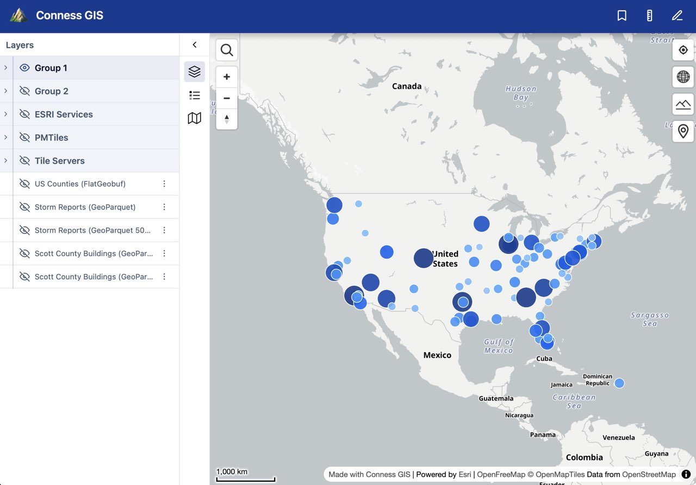
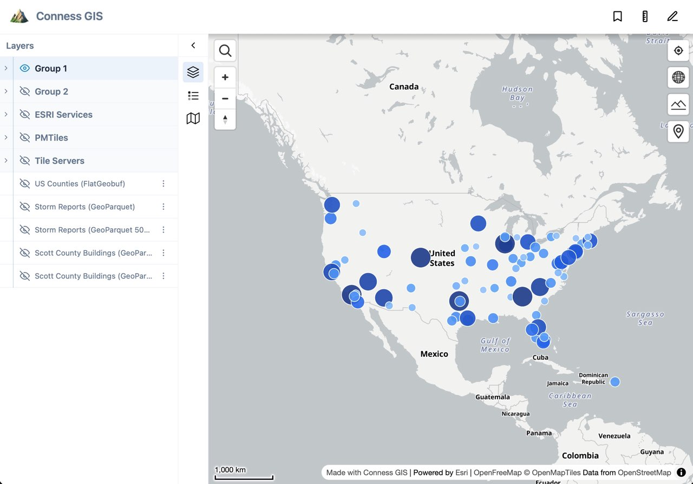
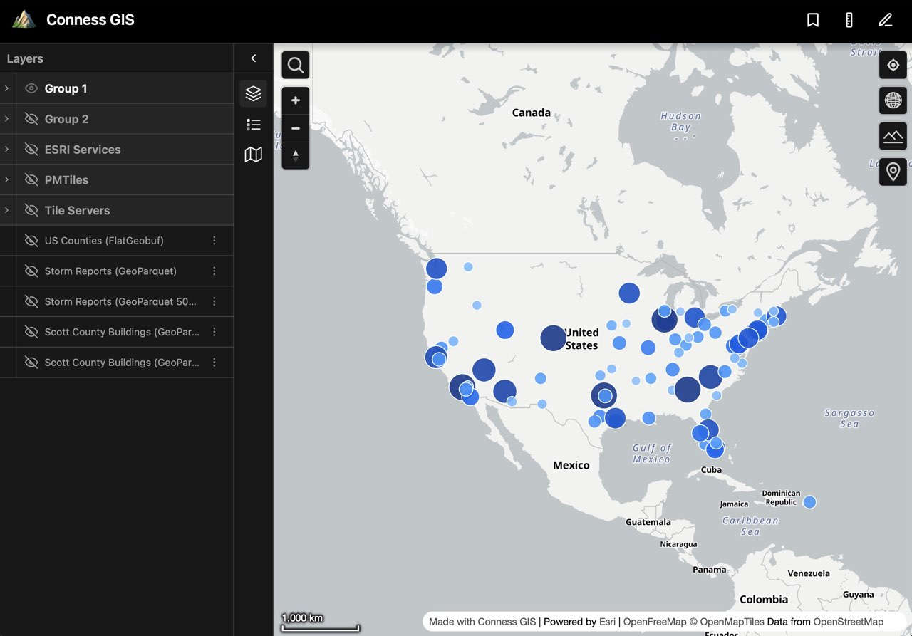
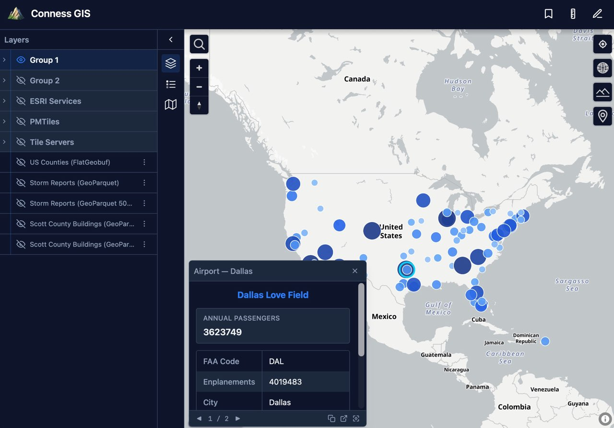

# Theme

Every color in the app comes from your project's `theme.json`. Pick a built-in preset, then override individual color tokens if you want. The app reads the file as `settings.theme`, the same way it reads `layers.json` and `basemaps.json`.

!!! tip "In the editor"
    **App Style** has the theme preset, and **Edit individual colors** opens every token below with a swatch picker. Reset to the preset's colors clears your overrides, and so does picking another preset, so you see the new preset as it is. The map buttons are at the end of that list: **Map controls bg** and **Map control icons** (black or white).

```json
{
  "$schema": "../../schema/theme.schema.json",
  "preset": "ocean",
  "colors": { "primary": "blue-900" }
}
```

Type `"` inside `colors` in VS Code to get the list of every token, with its role and default.

## Fields

| Field | Type | Default | Description |
|---|---|---|---|
| `preset` | string | `"conness"` | The built-in palette: one of the presets below |
| `colors` | object | none | Per-token overrides on top of the preset |
| `widgetTitleColor` | `"text" \| "primary"` | `"text"` | Color of widget panel titles in the top-bar panel, the side panel and floating pop-outs. A placement's own `header.titleColor` wins |
| `mapControlIcons` | `"black" \| "white"` | whichever reads on the buttons | Icons on the map's controls and the floating widget buttons. See [Map controls](#map-controls) |

Colors resolve the same way as every other setting in the kit:

> kit default ← `preset` ← `colors`

An unknown preset name is reported when the project's files are read (`theme.json → preset`), with the valid options; see [Concepts](../getting-started/concepts.md#checking-your-files).

## Presets

| Preset | Mode | Look |
|---|---|---|
| `conness` | light | Navy brand color and top bar, slate text on white panels. The kit default |
| `light` | light | White panels, a white top bar, sky-blue accents |
| `grays` | light | Light gray panels and a gray top bar, so the map carries the color |
| `dark` | dark | Black and white: neutral gray panels, a black top bar, no tint |
| `dark-blues` | dark | Slate-900 panels and top bar, blue accents |
| `mars` | dark | Warm charcoal panels, a rust-red brand color and top bar, orange accents |
| `evergreen` | dark | Deep green panels, a bright green brand color, a dark green top bar |
| `ocean` | light | Sea-glass cyan panels, teal brand color, deep-cyan top bar, sky-blue accents |
| `lavender` | light | Soft violet panels under a deep purple top bar |
| `meadow` | light | Pale green panels, a forest-green brand color and top bar |
| `sand` | light | Warm stone panels, an amber brand color, an espresso top bar |

Here's how four of them look:

<div class="preset-grid" markdown>
<figure markdown>
{ loading=lazy }
<figcaption>conness</figcaption>
</figure>
<figure markdown>
{ loading=lazy }
<figcaption>light</figcaption>
</figure>
<figure markdown>
{ loading=lazy }
<figcaption>dark</figcaption>
</figure>
<figure markdown>
{ loading=lazy }
<figcaption>dark-blues</figcaption>
</figure>
</div>

`light` and `dark-blues` color the top bar like the panels. The other presets give it a color of its own.

A dark preset changes more than colors. The browser's own controls (scrollbars, dropdown menus) render dark, and the map's control buttons take the dark panel color with white icons.

## Color tokens

A token's value is one of:

- a Tailwind color name and shade, like `"indigo-700"` or `"rose-600"`, from [Tailwind's palette](https://tailwindcss.com/docs/colors);
- `"white"`, `"black"` or `"transparent"`;
- another token's name (`"primary"`, `"panelBg"`, `"text"`) to follow that token: `"save": "primary"` keeps the Save button on your brand color, whatever it is.

Names are case-sensitive. The settings editor only offers these, and refuses anything else.

Every token is optional. Leave out a token, or the whole `colors` block, and it falls back to the preset. Many tokens follow `primary`, so changing `primary` alone recolors most of the app.

!!! tip "Why Tailwind names instead of hex?"
    The Tailwind palette keeps colors consistent with each other, and lets the settings editor offer a swatch picker instead of a color wheel. A hex, `rgb()`, `hsl()` or `oklch()` value in `colors` stops the app at startup with an error naming the token, so a wrong value can't quietly blank a color. Inside your own widgets you can use any color you like.

Defaults below are from the `conness` preset, in the order the editor lists them.

**Text and top bar**

| Token | Default | Role |
|---|---|---|
| `primary` | `blue-900` | Brand color: active states, focus rings, primary buttons, and the top bar through `topBarBg` |
| `text` | `slate-600` | Body text, inputs, dropdowns, readouts and idle icons: most of the text in panels, popups and the info modal |
| `titleText` | `white` | The app title in the top bar. Must contrast with `topBarBg` |
| `strongText` | `slate-900` | Names, titles and emphasized text: layer, legend and basemap names, bookmark and drawing names, dialog titles, popup titles and values. Icon buttons turn this color on hover |
| `topBarBg` | `primary` | Top bar background, and the phone's bottom widget bar |
| `topBarWidget` | `white` | Top-bar widget icons, the info button and the mobile carousel, in the top or bottom bar. Must contrast with `topBarBg` |

**Panels**

| Token | Default | Role |
|---|---|---|
| `panelBg` | `white` | Background of the side panel, widget panels, popups, dialogs, dropdowns and inputs |
| `panelBorder` | `slate-200` | Panel borders and dividers |
| `panelWidget` | `black` | Side rail widget icons and the side panel's collapse chevron. `black` on light presets, `white` on dark ones |
| `surface` | `slate-100` | Info sections, the popup header and footer, section headers, chips, Measure's unit boxes |
| `layerGroupBg` | `surface` | Layer list group header rows |

**Actions**

| Token | Default | Role |
|---|---|---|
| `danger` / `dangerHover` | `rose-600` / `rose-700` | Delete and clear buttons |
| `success` / `successHover` | `emerald-600` / `emerald-700` | Confirm buttons, like draw's "done" |
| `disabledBg` / `disabledText` | `gray-200` / `gray-400` | Disabled buttons |
| `actionActive` / `actionActiveHover` | `primary` / `primaryDarker` | Selected tool button (draw, measure) |
| `actionNotActive` / `actionNotActiveHover` | `white` / `slate-50` | Idle tool button |
| `save` / `saveHover` | `primary` / `primaryDarker` | Save buttons (bookmarks, draw) |

**Accents**

| Token | Default | Role |
|---|---|---|
| `hover` | `amber-500` | List row hover: a light tint of this color |
| `slider` | `primary` | Toggle switches when on, and range sliders |
| `popupHeaderBg` | `surface` | Popup title bar |
| `popupArrow` | `text` | Popup pager arrows |
| `dropdownHover` | `primary` | Dropdown focus (measure's unit selectors) |
| `featureHighlight` | `cyan-400` | The outline of the feature whose popup is open ([Popups](popups.md#highlight)); `amber-400` in the `ocean` preset, whose brand is cyan, and `fuchsia-500` in `meadow`, whose brand is green |

`primaryDarker` is a special value: `primary` made about 15% darker, recomputed from whatever `primary` is. Hover states use it.

Buttons with a solid colored fill (`primary`, `danger`, `success`, `save`, `actionActive`) and colored top bars use white text, so keep those tokens dark enough for white text to read.

## Map controls { #map-controls }

MapLibre's controls (zoom, compass, geolocate, globe, terrain, fullscreen), the zoom readout, the scale bar and the floating widget buttons over the map share one look. Their pop-outs, like Search's results, keep the panel colors.

| Setting | Default | Role |
|---|---|---|
| `colors.mapControlBg` | the panel color (`panelBg`) | Background of every map button |
| `mapControlIcons` | whichever reads on the buttons | `"black"` or `"white"` icons, and the zoom readout and scale bar text |

Icons come in black or white only, because MapLibre's own icons are fixed images. A widget's icon is drawn in exactly the same gray, so Search sits next to the zoom buttons without looking different. The compass's red tip and Locate me's blue (tracking) and red (error) keep their colors.

Left unset, `mapControlIcons` looks at the button color: a dark one gets white icons, a light one black. Change `mapControlBg` and the icons follow.

The scale bar draws its lines and text a step stronger than the icons, in pure black with black icons and pure white with white icons, outlined in `mapControlBg` so it reads on any basemap. The credits (attribution) don't follow the theme: they keep MapLibre's light box with dark text on every preset, so they're always readable.

## Examples

Keep a preset and change only the brand color:

```json
{
  "$schema": "../../schema/theme.schema.json",
  "preset": "conness",
  "colors": { "primary": "emerald-700" }
}
```

A light top bar on the default palette:

```json
"colors": { "topBarBg": "white", "titleText": "slate-900", "topBarWidget": "slate-600" }
```

## What the theme doesn't control

- **Map geometry colors.** The shapes the Draw and Measure widgets paint on the map, and the amber highlight on a hovered drawing, use fixed colors. They need many distinct colors and must read on any basemap. The widgets' panels do follow the theme.
- **Layer styling.** Set per layer through [Symbology](symbology.md), with label defaults in [`ui.layerDefaults`](ui-layout.md#global-layer-defaults).
- **The map background.** That's `map.backgroundColor`; see [Map & Camera](map-camera.md).
