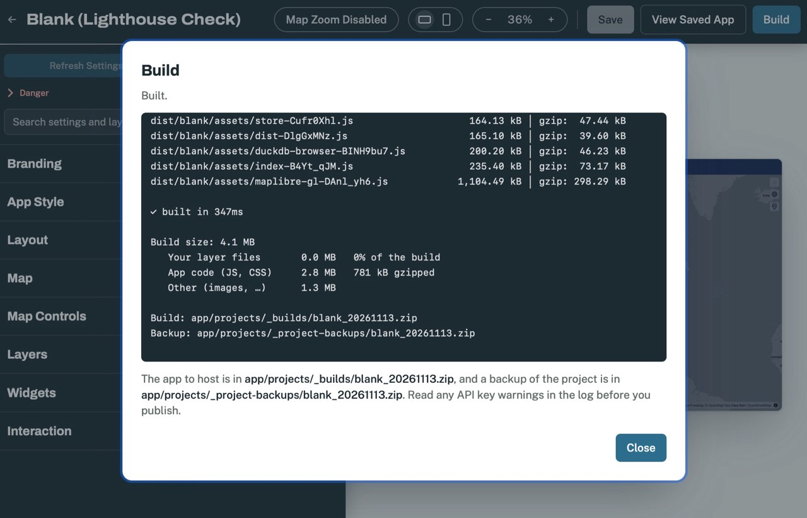

# Build & Backups

## Build

**Build** (in the top bar) builds the saved project into an app you can host on any static web host. With unsaved changes, it offers to save them first. A dialog shows the build's output as it runs. Read any [API key warnings](../guides/api-keys.md#the-build-warning) in it before you publish.

{ loading=lazy }

Each build saves two zips, named with the date:

- **The app to host**, in `app/projects/_builds/<project>_YYYYMMDD.zip`. Unzip it and upload its contents to your host. It includes `LICENSE.md` (Conness GIS's Apache 2.0 license) and `third-party-licenses.txt` (the licenses of the libraries bundled into it), which the licenses ask you to keep with the app. Leave them in.
- **A backup of the project folder**, in `app/projects/_project-backups/<project>_YYYYMMDD.zip`: its settings, data files, images, popup templates and info text, so every hosted version can be traced to the settings that made it.

A second build on the same day adds `-2`, then `-3`. Older zips stay until you delete them, and each one carries the project's layer files, so with large layers `_builds/`, `_project-backups/` and `_trash/` grow fast. Clear out old zips now and then. It's safe, since the project itself lives in its own folder. `npm run build <project>` does the same build from the terminal.

## robots.txt and llms.txt { #robots-and-llms }

Every build adds two small files for crawlers. `robots.txt` lets all search engines in. `llms.txt` is for AI crawlers: it has the title, the [description](../configuration/branding.md), the names of the layers and a "made with Conness GIS" link. To change either one, put your own file with that name in the project's `public/` and edit it by hand. It replaces the generated one. Or update the generated one in the dist, either or.

## Importing a backup

A backup is a whole project, so the projects page's **Import** takes it back as a new project folder. That's how you restore an older version, or move a project to another computer. See [Projects Page](projects.md).

### Backup or build? { #backup-or-build }

The two zips hold different things. Only the backup can be imported, the dist is build code and is meant to be hosted.

| | Backup (`_project-backups/`) | Build (`_builds/`) |
|---|---|---|
| What it is | The project's own files | The finished site to host |
| Contents | The five JSON files, `popups.tsx`, `info.md`, `layers/`, `public/`, `basemap-images/` | `index.html`, the bundled JS and CSS, the data, `LICENSE.md`, `third-party-licenses.txt` |
| Import and edit it | Yes | No |

A build never contains the backup, so keep the backups to be able to edit a hosted app later. You can optionally add these backup zips to your GitHub repo to keep them backed up. [Quick Start](../getting-started/quick-start.md#put-it-on-github) shows how to commit them if you want them there.
