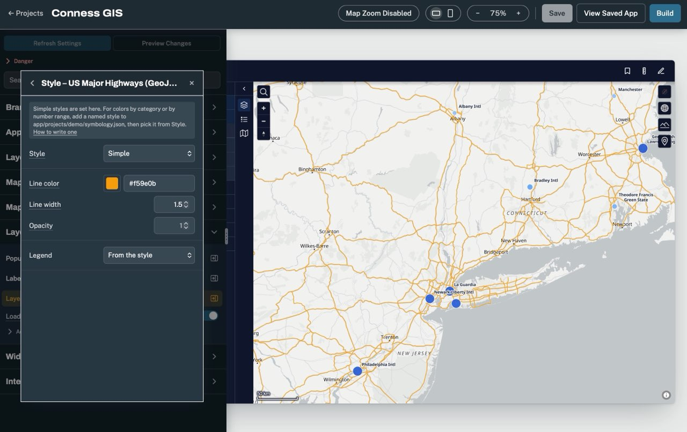

# Layers

**Add layer** asks for:

- **Name**: shown in the layer list and legend.
- **Where the data is**: a file in the project's `layers/` folder, picked from the ones there or uploaded, or a URL (**From a URL**). Uploading copies the file into the project right away. Only files a layer uses go into a build, so a leftover file in `layers/` never ships.
- **Kind**: GeoJSON, PMTiles, FlatGeobuf or GeoParquet file, a tile server, or an Esri feature, map or tiled service. It's guessed from the file name or URL, but can sometimes be wrong. You will need to manually change the type if it is wrong. This will happen specifically for ESRI services on occasion, so you may have to try a couple different types.

A URL is checked before it's added. For Esri services the check also reads the service's description, so it tries to pick the right kind, and adds the layer number to a FeatureServer that has only one layer.

New layers go on top of the list, with a simple style in a color no other layer uses.

## Ordering and groups

**Layers** lists the layers and groups in the order the layer list shows them. That's also the drawing order: the top one is drawn on top. Drag a row by its handle to move it.

A group is a shaded row with a folder icon and its layer count, with its layers indented under it. To put a layer in a group, drag it under the group's header or between its layers. While you drag, the layer indents and the group it would join lights up. To take a layer out, drag it left (or press Alt+← on its handle). It lands just below the group. Dragging a group moves it with all its layers, and it never lands inside another group. Groups within groups is a planned addition, but is not available right now.

**New group** adds an empty group at the top. An empty group shows a dashed **Drag layers here** spot to drop the first layer onto, and keeps its place in the list like any other group. Removing a group's last layer leaves the group empty, not gone.

Opening a group gives its name (**Rename**), **Start collapsed**, and **Ungroup**, which keeps its layers. An empty group has **Remove group** instead.

## A layer's screen

{ loading=lazy }

The top of the screen has what most layers need: **Source** (the file or URL), **Name**, **Geometry type** and **Visible at start**. Below it are links to the layer's other screens:

- **General**: the layer's group, its zoom range and the settings of its own kind, with the rest under Advanced.
- **Style**: **Simple** (a color, size, stroke and opacity, named for what they paint: fill and border, dot and ring, or line), or a named style from the project's `symbology.json`. Colors by category or by number range are written in `symbology.json`, then picked here. See [Symbology](../configuration/symbology.md). **Legend** chooses whether the legend reads its entries from the style, hides the layer, or shows custom entries you set.
- **Labels**: **Show labels**, then **Column**, or **Custom Label** to mix words and columns (`{faa_id}: {name}`). Their size, colors, position and offset follow Label defaults until you overwrite them for the layer. Offset shows only while the position is a corner. Line layers also get **Repeat spacing**, the distance between repeats of a name along a line. A label written as an `expression` in `layers.json` isn't editable here, and the screen says so.
- **Popup**: **Show popups**, the **Header** (the bar along the top; columns in braces, as in labels), the **Title** (a column shown at the top of the content), and **Fields**: **Choose columns** picks which columns show, in what order, each with its label. With none chosen, every column shows. The rest follows Popup defaults until you overwrite it.
- **Filters** (GeoJSON, GeoParquet and Esri feature layers): columns people can filter the layer by from its menu in the layer list: **Categorical** (a checklist of the column's values) or **Numeric** (one condition).

Columns are read from the layer's data by The Preview Pane, so a layer you just added lists its columns once it has loaded.

### PMTiles and tile servers

Their tiles hold one or more source layers, and each source layer has its own style. The editor reads the names from the tiles and writes them all into the layer, so there's nothing to set up first.

With one source layer, the screen looks like any other layer's: **General**, **Style**, **Labels** and **Popup**. With two or more, it has no Geometry type on top, since each source layer has its own, and its links are:

- **General**, which adds **Start collapsed** under the group.
- **Source layers**: **Choose source layers** picks which ones are drawn, and the list sets their order (the top one is drawn on top). This link also shows when the tiles hold more source layers than the one being drawn.
- **Default labels** and **Default popup**, used by the source layers that don't set their own.

A source layer's screen is laid out the same way: **Name** (with two or more), **Geometry type** and **Visible at start** on top, then **General** (its zoom range and its name in the tiles), **Style**, **Labels** and **Popup**, and **Remove source layer** at the bottom.

## Removing a layer

**Remove layer**, at the bottom of a layer's screen, also removes the Search entries that use it. **Also delete layers/<file>** moves its data file to `app/projects/_trash/` when you Save; without it, the file stays in `layers/` and simply isn't built.
