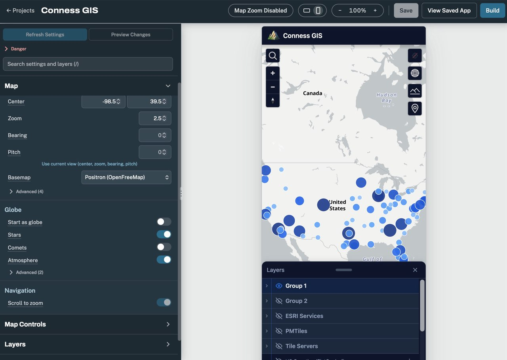

# The Preview Pane

The Preview Pane is your app, running beside its settings with your unsaved changes.

{ loading=lazy }

## Devices and zoom

The top bar's device buttons show the app at a desktop size (1440 × 900) or a phone size (402 × 874), the phone layout included. The app runs at that real size, scaled to fit. The zoom buttons scale it from 25% to 200%, and the percentage returns to Fit. **Map Zoom Disabled** stops the mouse wheel from zooming the map, so scrolling around the canvas doesn't move it. Turn it on to zoom with your mouse wheel. I like to keep it off and test out the map in a preview tab.

## Live changes and Refresh Settings

Most changes show in The Preview Pane a moment after you make them, without reloading the app: colors and sizes, the title and logo, layers (added, removed, reordered, restyled, their labels and popups), basemap edits, map controls (terrain included), the map's background color, Commercial Use, the layout and where widgets sit, and each widget's own settings.

Turning `Commercial Use` on drops the restricted sources from the widget, and switches off any that are working. Right now, we only have two sources that are not allowed to be used for commercial applications: ESRI Satellite Imagery and the Nominatim geocoder.

A few changes need the app to start again via the `refresh settings` button: adding, removing or moving a basemap, basemap thumbnails, DuckDB's file locations and the storage ID (`branding.appId`). For those, **Refresh Settings** (at the top of the sidebar) lights up; click it to reload The Preview Pane with them. The reload keeps where you were: the camera, which layers are on, their transparency, labels and filters, the basemap, the globe and terrain, and the open widgets. It keeps them per project, so opening another project starts it at its own camera and globe. Settings that only matter when the app starts, like the starting camera, a layer's Visible at start or Load only visible layers (`map.onlyVisibleOnLoad`), apply the next time it starts, or in a new preview tab.

## Preview Changes and View Saved App

- **Preview Changes** opens the app with your unsaved changes in a new browser tab, full size.
- **View Saved App** opens the app as it's saved in the files, what Build would build, your current production application.
