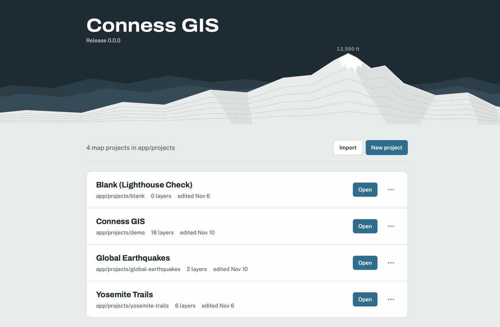

# Projects Page

The editor is where you build your apps. It runs on your own computer, started from `app/` with:

```bash
npm start
```

Open the URL it prints in a desktop browser. It edits your projects' files directly on your computer. Nothing is uploaded anywhere, and what it writes are the same plain files described in [Configuration](../configuration/branding.md), so you can switch between the editor and a text editor at any time.

The editor opens on a list of the projects in `app/projects/`, by name, with each one's folder, how many layers it has and when it was last edited.

{ loading=lazy }

- **New project** asks for a name and copies the starter into a new folder. The name is the app's title; the folder name (its project ID) comes from it: "Mammoth Lakes" becomes `mammoth-lakes`, with `-2` added if that's taken.
- **Import** takes a project zip: a backup from `app/projects/_project-backups/` (every Build writes one, see [Build & Backups](build.md#backup-or-build)), or a project folder you zipped yourself. A build from `_builds/` can't be imported, and picking one says to use the backup instead. Import asks for a name, filled in from the zip, and adds the project as a new folder. The project keeps its storage ID (`branding.appId`), so an app restored from a backup keeps its visitors' saved bookmarks and drawings, unless another project already uses that ID. A project made with an older release is upgraded as it's imported, and **Project upgraded** lists what changed. One made with a newer release is refused before anything is written.
- **Open** opens the project in the editor. If it was made with an older release whose settings have since changed, its files are upgraded on disk as it opens, with no extra backup (the last build's backup is your copy), and **Project upgraded** lists the changes once. A project made with a newer release won't open until you update Conness GIS.
- The **⋯** menu on each project:
    - **Rename** changes its title, shown in the app's top bar. The folder (project ID) stays.
    - **Duplicate** copies it, data files too, under a new name and storage ID.
    - **Rename project ID (folder)** renames its folder (project ID). Its builds and backups are renamed with it.
    - **Delete** moves its folder to `app/projects/_trash/`. To get it back, move the folder back from there manually.

A project whose files don't pass the [checks](../getting-started/concepts.md#checking-your-files) shows "has config problems" under its name. Open it to see and fix them.
