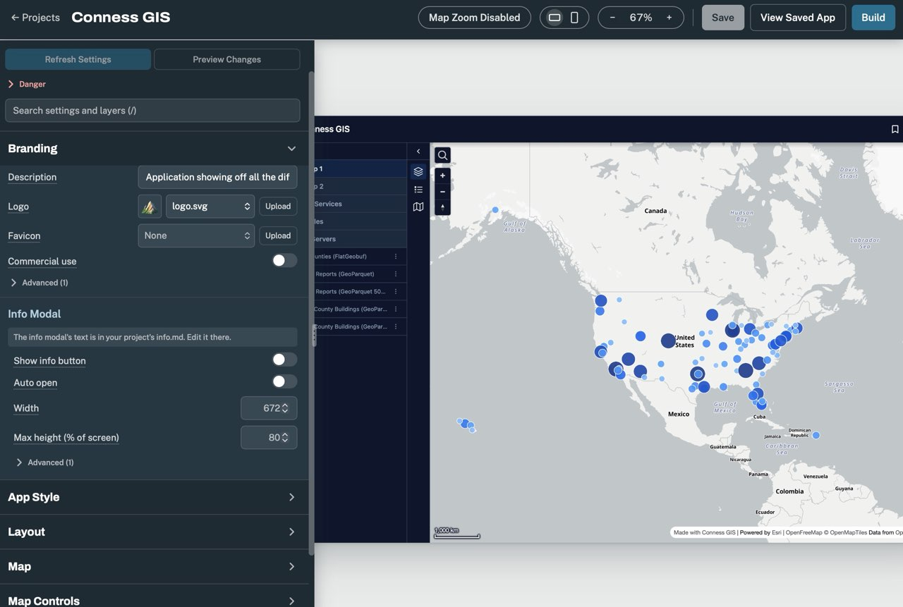

# Editing Settings

An open project has its settings in the sidebar on the left and [The Preview Pane](preview.md) on the right.

{ loading=lazy }

## The sidebar

Settings are in groups: **Branding**, **App Style**, **Layout**, **Map**, **Map Controls**, **Layers**, **Widgets** and **Interaction**. One group is open at a time. Drag the sidebar's right edge to make it wider if it's not wide enough for you as is.

In **App Style**, above the text sizes, **Make text smaller** and **Make text bigger** move every text size by 1 px at once. At the top of **Layout**, **Make logos/icons smaller** and **Make logos/icons bigger** do the same for the logo, the top bar and side rail icons, the info icon and the floating buttons. **Reset sizes**, next to each pair, puts every size in its group back to the default.

Each row is one setting. A value you haven't set shows its default, dimmed. Once you set it, it will appear normally. Every setting will have a  **Reset** button which will  go back to the default. Click a setting's name to read what it does, its default and a link to its docs page. Settings used less often sit under **Advanced** at the end of their section.

In **Layout**, the switch beside **Top Bar** and **Side Rail** shows or hides that bar, like a widget's switch; while it's off, its settings are hidden. Show branding is in Top Bar, and each bar has **Open at start**: a list of its widgets, plus Closed, for the panel that's open when the app loads.

Some settings depend on others and appear only when they apply: a label's Offset while it sits at a corner, a widget's settings while it's placed, a layer's tile limits while it draws vector tiles.

## Search

The search box at the top of the setting sidebar (press `/` or ⌘K) finds settings by name, by their name in the files, and layers by name. Pick a result and the editor opens its group, and its pop-out if it has one, and flashes the row.

## Pop-outs

A row with a panel icon opens a **pop-out**: a window for one thing in more detail, like a layer, the list of basemaps, or the theme's colors. It opens over the sidebar, which dims behind it, so The Preview Pane stays in view. It grows and shrinks with the sidebar. Inside it, screens open one from another, and **Back** returns to the last one where you left it. Close it with ×, Esc, or a click on the dimmed sidebar.

A number box that's empty shows its default in gray. Its arrows, or ↑ and ↓, step from that default.

## Defaults and overrides

Settings follow the rule described in [Concepts](../getting-started/concepts.md#the-resolve-merge-order): a kit default, then an app-wide setting, then one item's own. In the editor:

- App-wide defaults for every layer, like **Label defaults** and **Popup defaults**, are in the Layers group.
- A layer's own Labels and Popup screens keep those defaults in an **Overwrite defaults for this layer** fold. Anything set there wins for that layer only. Reset returns it to the default.
- A widget's own settings work the same way against Widget Headers.

## Starting view

Map › Starting View has the camera the app opens on: center, zoom, bearing and pitch. Move the preview to the view you want, tilted or turned if you like, and click **Use current view** under Pitch to copy all four. Bearing and pitch are only written when they're not 0. The background color behind the map, under Advanced, has a color picker.

## Widgets

Under **Widgets**, each widget has an on/off switch and, when on, where it goes (**Where**: the top bar, the side rail, or a map corner, whichever the widget supports) and whether it's in the mobile carousel. Its own settings follow, and a group of them that belongs together gets its own pop-out, like the Basemap widget's **Hillshade**. **Reorder widgets** lists the top bar, side rail and mobile carousel: drag to reorder, between the top bar and side rail to move a widget (if it can go there), or into Mobile to add it to the carousel. **Arrange corners** (Map Controls) does the same for each map corner's stack, controls and floating widgets alike.

## Elevation source

Terrain (Map Controls › Terrain Button › Terrain source) and the hillshade (Widgets › Basemap › Hillshade › Elevation source) open the same screen. **Elevation tiles** picks Mapterhorn, the default, a tile URL template or a TileJSON URL. The URL box shows the URL in use in gray. Typing in it turns it into a tile URL template of your own, and picking Tile URL template starts from Mapterhorn's. Encoding, tile size and max zoom follow under it.

## Saving

Changes stay in the editor until you click **Save** in the top bar; the top bar says **Unsaved changes** until then, and the browser asks before you leave the page with changes unsaved. Before saving, **Preview Changes** opens the app with your changes in a new tab.

Save writes only the files that changed. If a file was changed outside the editor since you opened the project (by hand, for example), Save stops and asks whether to overwrite it. If you do not want to, cancel and reload the page to pick up the hand edit instead.

**Reset all** (at the top of the sidebar) puts the project's settings, theme and basemaps back to the starter's, including the description, favicon and starting basemap. It keeps the title, logo, storage ID and starting view (center, zoom, bearing and pitch), and everything about the layers: the layers and their symbology, their groups, Label defaults and Popup defaults. It changes the draft only, so you can still leave without saving.
