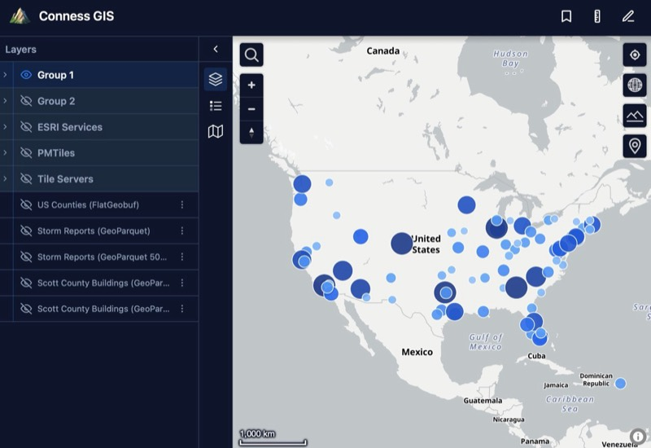
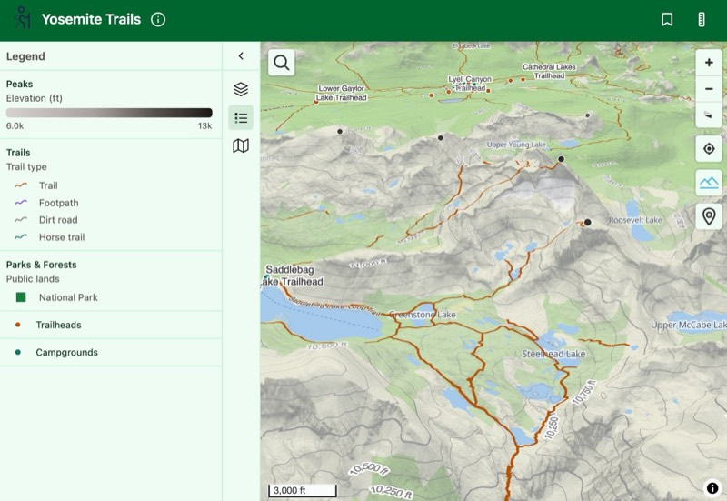
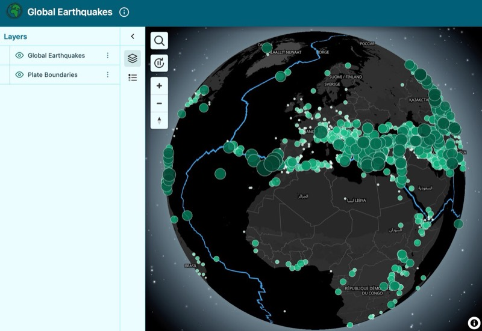
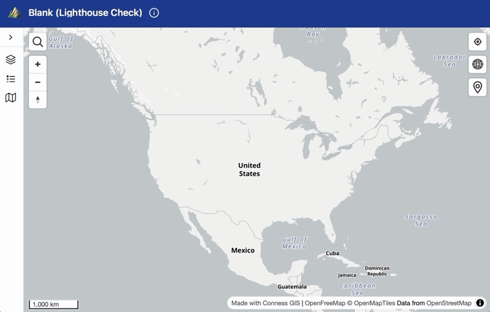
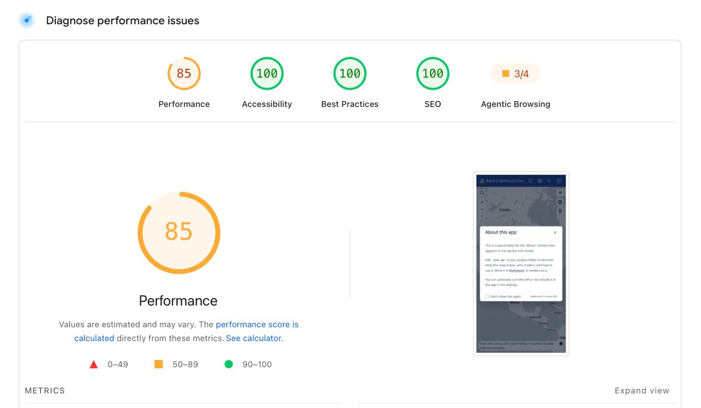

# Examples

[{ loading=lazy }](https://demo.conness-gis.com){ target=_blank rel=noopener }

[{ loading=lazy }](https://yosemite-trails.conness-gis.com){ target=_blank rel=noopener }

[{ loading=lazy }](https://global-earthquakes.conness-gis.com){ target=_blank rel=noopener }

[{ loading=lazy }](https://blank-lighthouse.conness-gis.com){ target=_blank rel=noopener }

## [Conness Demo](https://demo.conness-gis.com){ target=_blank rel=noopener }

The main demo project, which loads every layer type Conness GIS supports, from GeoJSON and PMTiles to GeoParquet and ArcGIS services.

## [Yosemite Trails](https://yosemite-trails.conness-gis.com){ target=_blank rel=noopener }

Trails, peaks, lakes and campgrounds around Yosemite, drawn over 3D terrain with hillshade and contour lines enabled from Mapterhorn.

## [Global Earthquakes](https://global-earthquakes.conness-gis.com){ target=_blank rel=noopener }

Earthquakes and tectonic plate boundaries on a spinning globe.

## [Blank](https://blank-lighthouse.conness-gis.com){ target=_blank rel=noopener }

An app with no layers and the standard widgets placed. I made it so I could test lighthouse and make sure things are optimized. Large map data will keep these scores down naturally, which is why there is no data in this example. The MapLibre package will inherently keep these scores down, but here is the Lighthouse report for this blank app:

{ loading=lazy }
