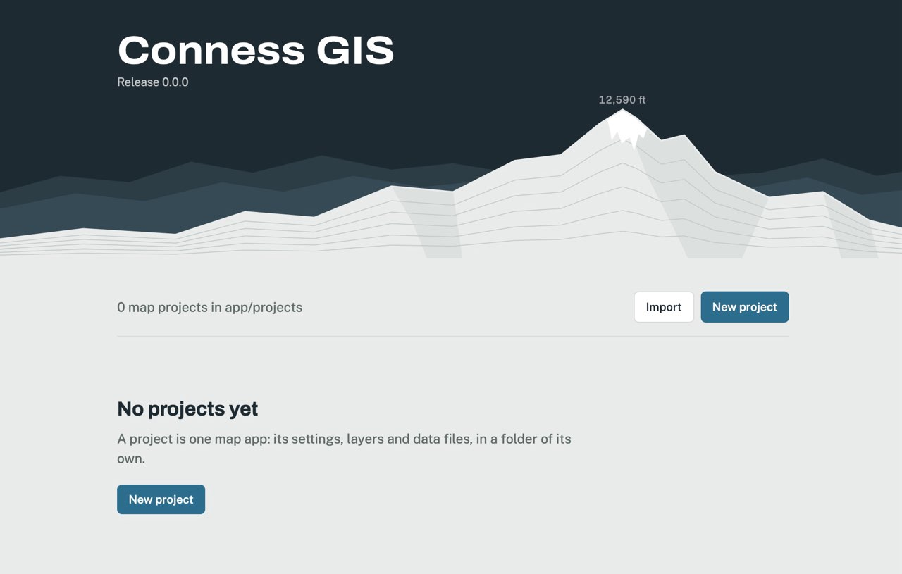
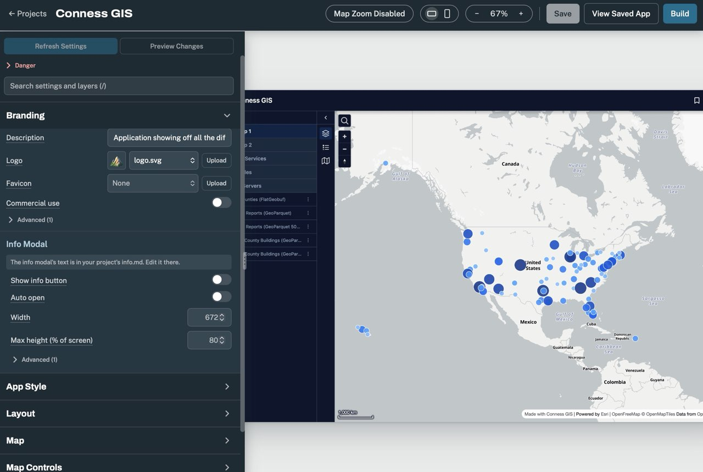

# Quick Start

Node 26 is recommended (see [Requirements](requirements.md)). Technically Node 24 and up will work, but just update to the new one, alright?

## Download

1. Download the latest release zip from the [Releases](releases.md) page and unzip it where you keep your projects. It unzips to a folder named for the release, like `conness-gis-1.0.0/`. There's no need to rename it.

I like to create a folder called GIS in my documents or something, then "conness" within there, since there will be multiple versions eventually. Or just keep it in your downloads like a barbarian.

2. Open a terminal in the unzipped folder, go into `app/` and install

    ```bash
    cd app && npm ci
    ```

    It will probably list some vulnerabilities at the end. Those are in dev tools like Vite and ESLint that run on your computer, not in the map you build (more in [Dependency alerts](../guides/api-keys.md#dependency-alerts)). Please don't run `npm audit fix --force`. It downgrades Vite and breaks the kit.

3. Start the editor from the same terminal

    ```bash
    npm start
    ```

    Every `npm` command runs from `app/`. Next time, from the unzipped folder, run `cd app && npm start`. It prints a local URL (<http://localhost:5173> by default). Open it in your browser:

{ loading=lazy }

The release comes with no projects. The editor opens on your projects page; click **New project** and give it a name, like "Mammoth Lakes". It becomes a folder, `app/projects/mammoth-lakes/`, copied from the starter: every basemap, the standard popups, no layers yet, and the Layer List, Legend and Basemap widgets in the side rail.

## Build your app

Open the project. The editor has your settings on the left and **The Preview Pane**, your app running, on the right:

{ loading=lazy }

1. **Name the thing.** Set the title and logo under Branding, and pick a color preset under App Style.
2. **Fix the Map View.** Move the map in The Preview Pane, then use **Use current view** for the starting camera, under Map.
3. **Add your data.** Under Layers, open Layers and click **Add layer**: upload a file or paste a URL. Then give it a style, labels and popups.
4. **Place widgets.** Turn them on and choose where they go, under Widgets.

Most changes show in The Preview Pane as you make them. Some wait for **Refresh Settings**. Nothing is written to your project until you click **Save**. See [The Editor](../editor/projects.md) for the whole tour.

When it's ready, click **Build**. The app to host is saved as a zip in `app/projects/_builds/`, with a backup of the project next to it. You can take the build and move it somewhere else to host, or you can host directly from your version of Conness. See [Build & Backups](../editor/build.md) and [Hosting on Cloudflare](../guides/hosting-on-cloudflare.md)

## Put it on GitHub

I would recommend keeping your copy of Conness-GIS in a repository of your own, so your projects have history and a backup:

1. Create an empty repository on GitHub, with no README, license or `.gitignore`, so the first push doesn't conflict.
2. From the unzipped folder (the one that holds `app/`):

    ```bash
    git init
    git add .
    git commit -m "Whatever I want to call my repo"
    git branch -M main
    git remote add origin https://github.com/<you>/<your-repo>.git
    git push -u origin main
    ```

The `.gitignore` that comes with the release leaves out the typical criminals: `node_modules/`, `app/dist/`, and the editor's own folders in `app/projects/`: `_builds/`, `_project-backups/` and `_trash/`, all matched by one line, `app/projects/_*/`. To keep builds or backups in the repository too, add the folders you want after that line:

```gitignore
app/projects/_*/
!app/projects/_builds/
!app/projects/_project-backups/
```

A build zip can be large, and a project's backup holds all its data files, so check your repository's size before you commit them. I would loosely recommend taking your project backups off of git ignore, but didn't want to make that decision for all users and bloat their repos, so up to you.

## Updating to a new release

Download the new release and unzip it, then copy your own folders into it: your projects in `app/projects/` and any widgets you wrote in `app/widgets/`. Run `npm ci` again, or for the first time if you haven't run it yet. Each release's changelog on the [Releases](releases.md) page says what changed. A change marked ⚠️, like a setting that moved, needs something from you. Each project's `settings.json` records the release it was made with in `connessVersion`. Leave it as it is.

Then open each project in the editor, or run `npm run upgrade <project>`, to bring it up to the new release. `npm run dev` and `npm run build` stop on a project that still needs it and will say which command fixes it. A release that doesn't change the settings leaves projects as they are, `connessVersion` included. A project can't go back to an older release.

## Hey, I hate the UI, but like the idea

No worries, everything the editor does, you can also do by hand. A project is a folder of plain files (`settings.json`, `layers.json` and a few more see [Concepts](concepts.md)), and the [Configuration](../configuration/branding.md) pages document every setting in them. Hover a setting in VS Code to see what it does, its default and a link to its docs.

## npm scripts

Run these from inside `app/`. Commands that work on a project take its folder name (also known as the project ID). Without one, they use the only project, if there is at least one. With several, it will stop and list your choices.

| Script | What it does |
|---|---|
| `npm start` | Start the editor |
| `npm run new "My Map"` | Create a project from the starter |
| `npm run dev [project]` | Run one project with hot reload, for editing its files by hand |
| `npm run build [project]` | Type-check and build the project into `app/dist/<project>/`, the same build as the editor's Build. It ends with a size report and the [API key check](../guides/api-keys.md#the-build-warning), then saves the dated zips in `_builds/` and `_project-backups/` |
| `npm run preview [project]` | Serve the built project locally |
| `npm run upgrade [project]` | Bring a project made with an older release up to this one, rewriting only the files that change. Says it's up to date when there's nothing to do |
| `npm run typecheck` | Type-check the kit and every project |
| `npm run lint` | Run ESLint |

Checkout [Concepts](concepts.md) if interested in seeing it all work together, but honestly, the above is enough to just get started with.
